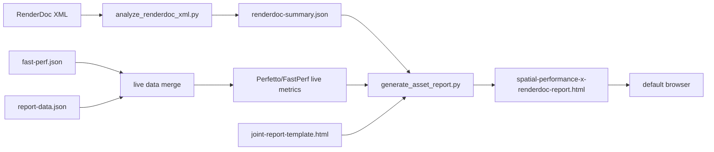
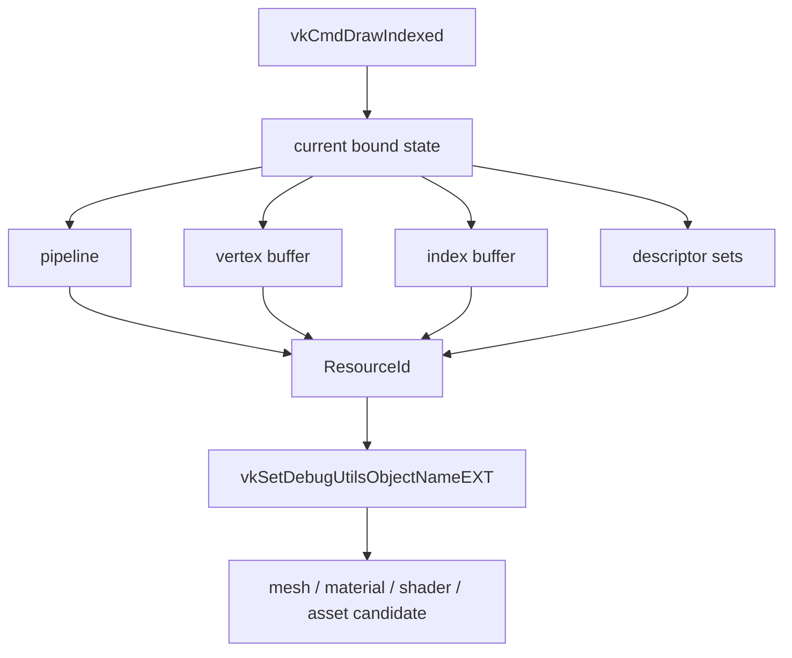

# Spatial Performance x RenderDoc Analysis Usage Guide

## 1. What this skill does

`spatial-app-performance-analysis-ext` is an extension of `spatial-app-performance-analysis`. It combines:

- RenderDoc-exported Vulkan XML: describes one frame's API, draws, pipeline, descriptor, image, buffer, barrier, and resource structure;
- Perfetto/FastPerf: describes FPS, Spatial Frame, CPU/GPU, GC, memory, and scheduling behavior over a continuous time window;
- Asset-attribution data: resolves mesh, material, and shader object names by looking up Vulkan Debug Utils `ResourceId` values;

into a single HTML performance report with explicit evidence boundaries.

It answers:

> "What did this single frame submit, which resources or assets deserve investigation first, and do those structures mechanistically support the live performance behavior?"

It never claims a confirmed GPU root cause from draw count or texture size alone.

## 2. When it triggers

The following requests usually trigger this skill:

- Analyze a RenderDoc-exported XML;
- Analyze `vkCmdDrawIndexed`, `vkCmdDispatch`, pipeline, descriptor, barrier, or image;
- Cross-check RenderDoc against Perfetto/FastPerf, SpatialFrames, GPU, FPS, memory, GC, or jank;
- Generate an HTML report with RenderDoc asset attribution and Top Texture;
- Locate high-frequency meshes, instanced draws, or large render targets from a RenderDoc single frame.

Direct `.rdc` analysis is not supported. Open the capture in a compatible RenderDoc/PICO RenderDoc build, manually export XML, and provide the XML file.

## 3. Data flow



### Data source responsibilities

| Data source | Primary content | What it cannot replace |
|---|---|---|
| RenderDoc XML | Single-frame API, draw, dispatch, resource, pipeline, descriptor, image, barrier | Continuous FPS, live frame time, real GPU duration |
| `fast-perf.json` | FastPerf samples, trends, and device-side sampling | The full set of PICO CLI aggregated Spatial frame statistics |
| `report-data.json` | PICO CLI aggregates such as `spr_frame_types`, `spr_stats` | RenderDoc resource-binding relationships |
| App Debug Utils names | `ResourceId -> ObjectName` for asset lookup | Textures or entities that carry no name |

`generate_asset_report.py` auto-discovers `report-data.json` in the same directory as, or a parent directory of, `fast-perf.json`; you can also pass `--report-data` explicitly.

## 4. Input preparation

### Minimum input

```text
renderdoc-export.xml
```

### Recommended input

```text
session-output-<timestamp>/
├── renderdoc-export.xml
├── performance-data/
│   ├── report-data.json
│   └── perf-data-<timestamp>/
│       ├── fast-perf.json
│       ├── trace-perf.perfetto-trace
│       └── collector-summary.json
├── topic-result/
│   ├── output-<topic>.md
│   └── output-<topic>.meta.json
├── final-summary.md
└── final-summary.meta.json
```

Filenames are not a fixed contract. The XML does not need to be named `Detail.xml`; any RenderDoc-exported XML is accepted.

## 5. Step 1: Parse the RenderDoc XML

```powershell
python scripts/analyze_renderdoc_xml.py `
  --xml <session-output>\renderdoc-export.xml `
  --out <session-output>\renderdoc-summary.json
```

The parser outputs:

- `vkCmdDrawIndexed` count;
- raw triangle estimate;
- instanced triangle upper bound;
- compute dispatch and group totals;
- pipeline, descriptor, vertex/index buffer bindings;
- pipeline barrier and nested barrier counts;
- image count, dimensions, mips, layers, samples, format;
- Top Texture / Image;
- `vkSetDebugUtilsObjectNameEXT` object names;
- ResourceId attribution from draws to mesh/material/shader candidates.

### Asset-attribution chain



In current `Detail.xml`-style data, if the following exists:

```xml
<ResourceId name="Object">87052</ResourceId>
<string name="ObjectName">
  Name: FX_Fish_Medium, Model: EngineMeshResource, Type: EngineMesh
</string>
```

then that ResourceId can be resolved to `FX_Fish_Medium`. If the XML has no Debug Utils name for a given Image, the report shows `unnamed`, which signals missing data rather than an inferred asset name.

## 6. Step 2: Generate the complete report

### Pass every data source explicitly

```powershell
python scripts/generate_asset_report.py `
  --renderdoc <session-output>\renderdoc-summary.json `
  --fastperf <session-output>\performance-data\perf-data-<timestamp>\fast-perf.json `
  --report-data <session-output>\performance-data\report-data.json `
  --out <session-output>\spatial-performance-x-renderdoc-report.html
```

### Open the default browser after generation

```powershell
python scripts/generate_asset_report.py `
  --renderdoc <session-output>\renderdoc-summary.json `
  --fastperf <session-output>\performance-data\perf-data-<timestamp>\fast-perf.json `
  --report-data <session-output>\performance-data\report-data.json `
  --out <session-output>\spatial-performance-x-renderdoc-report.html `
  --open-browser
```

`--open-browser` opens the `file:///...` URL in the system default browser after the HTML is written successfully. With no desktop environment, a remote terminal, or a browser policy restriction, the HTML still remains at the output path.

### Auto-discover `report-data.json`

If `report-data.json` sits in the same directory as, or any parent directory of, `fast-perf.json`, you can omit `--report-data`:

```powershell
python scripts/generate_asset_report.py `
  --renderdoc <session-output>\renderdoc-summary.json `
  --fastperf <session-output>\performance-data\perf-data-<timestamp>\fast-perf.json `
  --out <session-output>\spatial-performance-x-renderdoc-report.html `
  --open-browser
```

## 7. Add asset attribution incrementally to an existing report

Incremental mode is for an existing complete Perfetto/FastPerf joint report, into which you only add the asset and Top Texture sections.

```powershell
python scripts/generate_asset_report.py `
  --renderdoc <session-output>\renderdoc-summary.json `
  --baseline <unfilled-baseline.html> `
  --out <session-output>\spatial-performance-x-renderdoc-report.html `
  --open-browser
```

The baseline must retain the template placeholder:

```text
{{ASSET_ATTRIBUTION}}
```

If the script cannot find that placeholder, it fails outright rather than guessing an insertion point or reordering sections. This prevents losing or duplicating the cross-validation, root-cause, A/B, and limitations sections.

## 8. How to read the report

Read the report in this order:

```text
live behavior
   ↓
RenderDoc single-frame structure
   ↓
cross-source evidence alignment
   ↓
asset / Top Texture
   ↓
root-cause candidates
   ↓
A/B validation
```

### Key sections

1. **Joint diagnosis summary**: confirm the live problem and the conclusion level.
2. **Perfetto / FastPerf metrics**: review FPS, Late, Miss, GPU frame, memory, and GC.
3. **RenderDoc Vulkan evidence**: review draws, triangles, dispatch, pipeline, barrier, render target.
4. **Cross-source evidence alignment**: distinguish `strong_cross_support`, `mechanism_support`, `independent_candidate`, and `not_comparable`.
5. **Asset-level RenderDoc attribution**: review high-frequency assets, the largest draws, and asset-mapping coverage.
6. **Top Texture / Image**: review dimensions, mips, layers, samples, declared size, and format.
7. **Root cause and A/B**: confirm the next validation step rather than treating a candidate as a conclusion.

## 9. Evidence boundaries

### Can be confirmed directly

- how many draws, dispatches, pipeline binds, descriptor binds, and barriers exist in the XML;
- whether a draw's currently bound ResourceId has a Debug Utils object name;
- image dimensions, mips, layers, samples, format, and declared size;
- the Late, Miss, FPS, GPU frame, and memory metrics actually recorded in Perfetto/FastPerf.

### Cannot be confirmed alone

- that a high draw count equals GPU being the sole root cause;
- that `declared image size` equals resident VRAM;
- that an XML chunk `duration` equals the real GPU duration;
- that a RenderDoc single frame and a 60-second Perfetto window are inherently the same frame;
- that an `unnamed` texture can be uniquely traced to a specific asset by size;
- that GC, Binder, or low-memory events necessarily belong to the target app and directly cause the abnormal frame.

## 10. FAQ

### Can I pass `.rdc` directly?

Not supported. Manually export XML from inside RenderDoc. Do not treat `.rdc` as XML, and do not infer render metrics from the header or file size.

### Why does `Spatial Late` show `n/a`?

Usually you passed only `fast-perf.json` without `report-data.json`. Add it explicitly:

```powershell
--report-data <path>\report-data.json
```

Or place `report-data.json` in the same directory as, or a parent directory of, `fast-perf.json`.

### Why are all textures `unnamed`?

The corresponding image ResourceId has no `vkSetDebugUtilsObjectNameEXT` name. You can analyze texture structure and size, but cannot reliably attribute it to a specific texture asset.

### Why can't an asset be judged the root cause directly?

Because RenderDoc mainly provides single-frame structure, while a live root cause needs same-window GPU timing, target-thread state, or a controlled A/B. Asset names improve investigation precision but do not replace causal validation.

## 11. Output files

A complete analysis should keep at least:

```text
session-output-<timestamp>/
├── renderdoc-summary.json
├── spatial-performance-x-renderdoc-report.html
└── provenance.json
```

The report should be UTF-8, and you should check that:

- no `{{...}}` template variables remain;
- no U+FFFD replacement characters remain;
- the HTML has a complete `</html>`;
- the metrics from the current inputs actually appear in the report;
- the report clearly separates single-frame evidence from live-window evidence.
