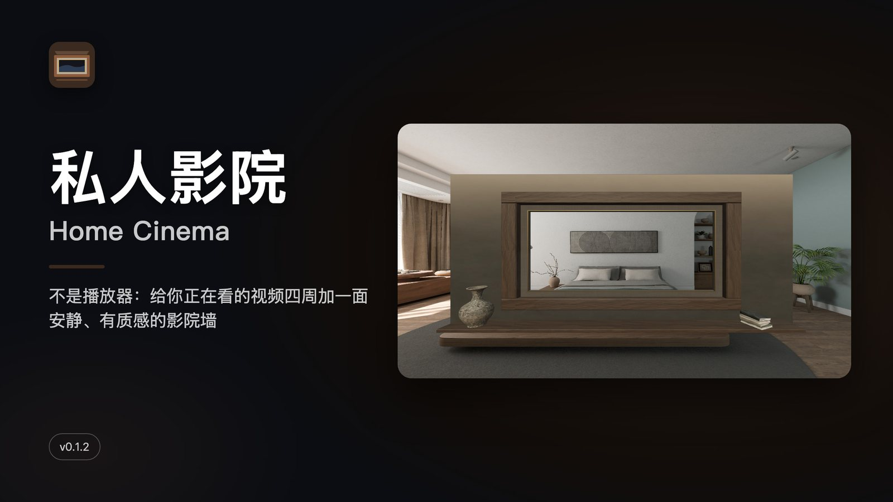
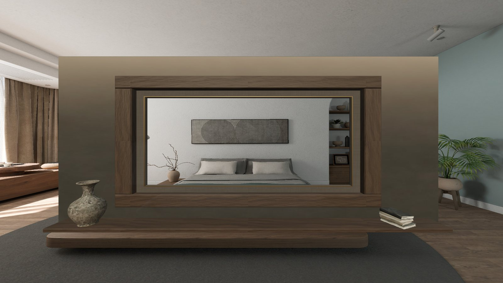
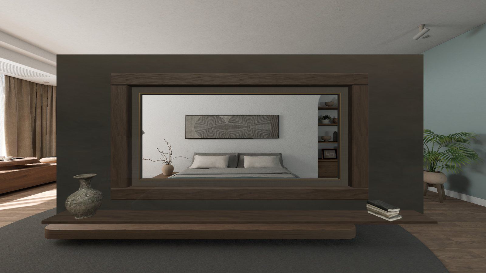
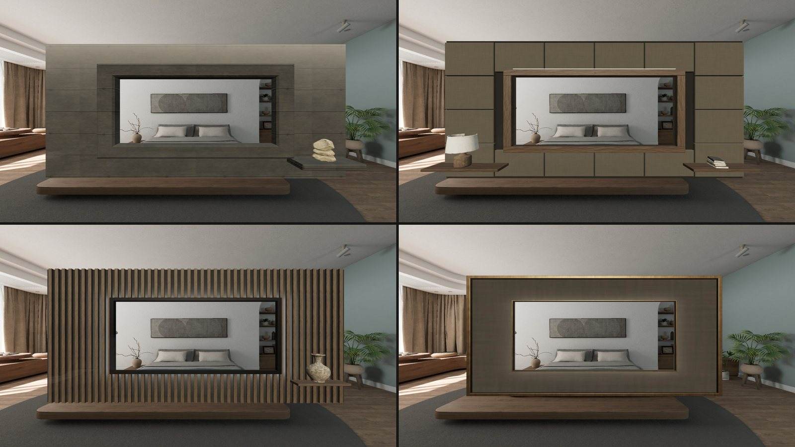
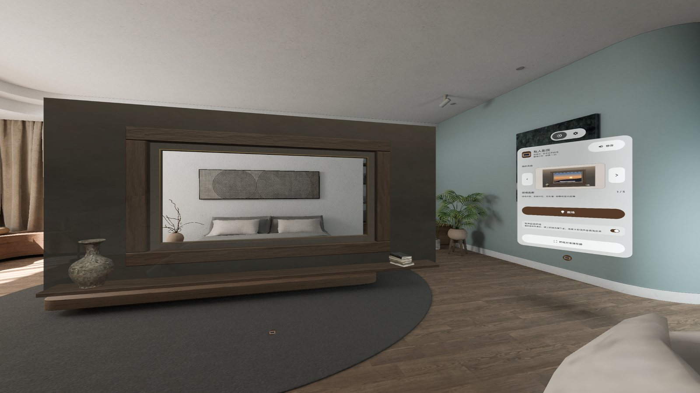
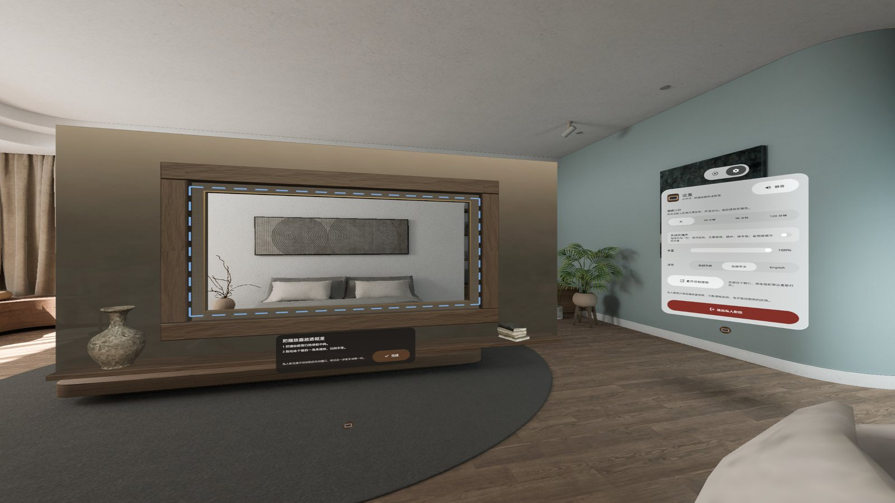

# 私人影院 Home Cinema



**中文** · [English](#english)

不是播放器，是给你正在看的视频加一层氛围。你照常用系统播放器、PICO Video 或浏览器看片，私人影院在那个窗口四周补一面安静、有质感的 3D 墙：低饱和、低亮度、真材质，不发光、不卡通。

PICO 空间应用（PICO OS 6 / Spatial SDK 6.1.9），Kotlin + SpatialUI。版本 v0.1.2。

## 截图

| | |
|---|---|
|  胡桃画廊 · 灯亮 |  同一视角 · 放映：柔光渐暗到 12 % |
|  清水混凝土 / 亚麻软包 / 烟熏橡木格栅 / 青铜细框 |  放映页：风格、开场 / 散场、有声自动开场 |
|  设置：睡眠计时、环境声、语言、退出 |  首次对齐：把播放器拖进框中间 |

截图来自模拟器（调试广播切换状态），不是真机画面。

## 功能

- **五种墙面**：胡桃画廊、清水混凝土、亚麻软包、烟熏橡木格栅、青铜细框。真 3D 模型、写实材质，每种只有一处很弱的柔光；切换 1.2 秒淡入淡出。
- **开场 / 散场**：别的应用开始出声，柔光 4 秒渐暗到 12 %；连续 8 秒没声音，6 秒亮回来。「开场 / 散场」按钮随时手动切换。
- **睡眠计时**：60 / 90 / 120 分钟，到点散场、停环境声，播放器不受影响。
- **可选环境声**（默认关）：室内底噪、天窗细雨、很轻的壁炉、闷闷的城市夜。
- **对齐**：第一次打开把播放器窗口拖进框中间，再拖框的一角等比缩放。开口里没有任何东西，不挡画面也不挡点击。
- 中英双语；设置里可退出；全部本机运行，不联网、不需要账号。

做不到的：不能调暗房间、不能换沉浸环境（进 Full Space 会让别的应用的窗口消失），不能自动套到播放器上，不能识别或控制别的应用里的视频。

## 安装

从 [Release v0.1.2](https://github.com/kejing-dev/HomeCinema/releases/tag/v0.1.2) 下载 APK：

```
adb install -r HomeCinema-v0.1.2.apk
pico-cli app launch io.embodit.homecinema
```

Release 里的 APK 是 `assembleRelease` 出的未签名包（上架用）；自己装到设备上先用自己的 key 签名，或者本地 `./gradlew assembleDebug` 装 debug 包。

## 构建

```
./gradlew assembleDebug        # app/build/outputs/apk/debug/app-debug.apk
./gradlew assembleRelease      # 未签名 release 包
./gradlew testDebugUnitTest
```

## 演示视频

Release 附带的演示视频是模拟器录屏，用调试广播（`adb shell am broadcast -a io.embodit.homecinema.DEBUG …`）驱动状态，**非真实手势录像**。

## 致谢

环境声全部来自 [freesound.org](https://freesound.org) 的 CC0 录音，只做了剪辑和循环拼接：

| 声音 | 风格 | 来源 | 作者 |
|---|---|---|---|
| 室内底噪 | 胡桃画廊 | [JM_AMB_Room Tone 01_MONO](https://freesound.org/people/Julien_Matthey/sounds/837886/) | Julien_Matthey |
| 天窗细雨 | 清水混凝土 | [January rain on a roof](https://freesound.org/people/mmorgaine/sounds/333509/) | mmorgaine |
| 很轻的壁炉 | 亚麻软包 | [Fireplace Flame](https://freesound.org/people/Ihaksi/sounds/649208/) | Ihaksi |
| 闷闷的城市夜 | 烟熏橡木格栅 | [Night city rumble quiet distant traffic](https://freesound.org/people/TRP/sounds/572530/) | TRP |

墙面和框由代码生成（three.js 导出 GLB）；陶瓶、画册、台灯、叠石等摆件由 Tripo 生成后减面。字体 Noto Sans（SIL OFL 1.1）。

---

<a id="english"></a>

# Home Cinema

Not a player. It adds a mood around the video you are already watching. Keep using the system player, PICO Video or the browser; Home Cinema puts a quiet, well-made 3D wall around that window: muted colours, low brightness, real materials, nothing glowing or cartoonish.

A PICO spatial app (PICO OS 6 / Spatial SDK 6.1.9), Kotlin + SpatialUI. Version v0.1.2.

## Screenshots

See the table above (Chinese UI). Screenshots are from the emulator, with states switched by debug broadcasts; they are not headset captures.

## Features

- **Five wall treatments**: Walnut Gallery, Béton, Linen Room, Smoked Oak, Bronze Line. Real 3D models with realistic materials, each with one faint soft light; switching cross-fades in 1.2 s.
- **Show / lights up**: when another app starts playing sound, the soft light dims to 12 % over 4 s; after 8 s of silence it comes back over 6 s. A big button switches by hand at any time.
- **Sleep timer**: 60 / 90 / 120 min; at the end the lights come up and the ambience stops. The player keeps playing.
- **Optional ambience** (off by default): room tone, skylight rain, a low fireplace, a muffled city night.
- **Align**: on first launch, drag the player window into the frame, then drag a corner of the frame to scale it. The opening is empty, so it never covers the picture or blocks your clicks.
- Chinese and English; exit from Settings; runs fully offline, no account.

What it can't do: dim the room or swap in an immersive environment (Full Space hides other apps' windows), snap to the player automatically, or read or control the video in another app.

## Install

Download the APK from [Release v0.1.2](https://github.com/kejing-dev/HomeCinema/releases/tag/v0.1.2):

```
adb install -r HomeCinema-v0.1.2.apk
pico-cli app launch io.embodit.homecinema
```

The Release APK is the unsigned `assembleRelease` build (for store submission). To sideload it, sign it with your own key first, or build and install the debug APK with `./gradlew assembleDebug`.

## Demo video

The demo video attached to the Release is an emulator recording driven by debug broadcasts. **It is not a recording of real hand input.**

## Credits

All ambience loops are CC0 recordings from [freesound.org](https://freesound.org), only cut and looped: room tone by Julien_Matthey, rain on a roof by mmorgaine, fireplace by Ihaksi, night city rumble by TRP (links in the table above). Walls and frames are generated in code (three.js → GLB); the props (vase, books, lamp, stacked stones) were generated with Tripo and decimated. Font: Noto Sans (SIL OFL 1.1).
